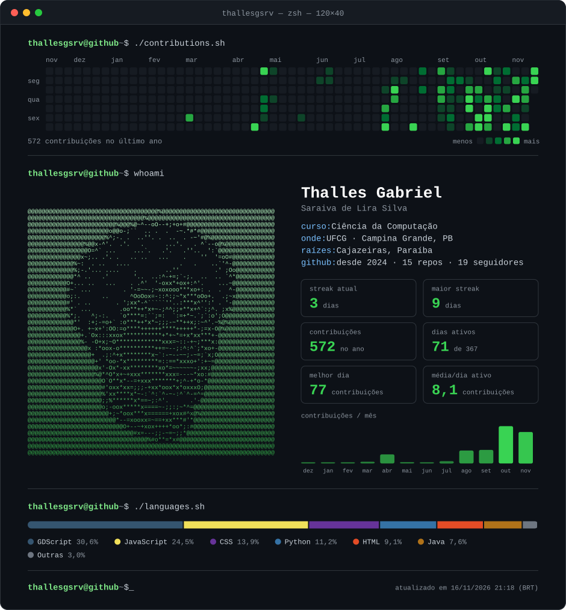
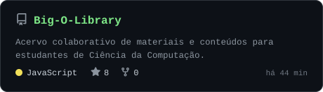
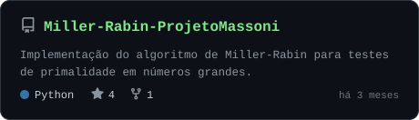
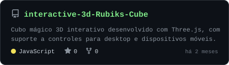
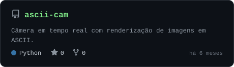
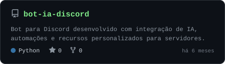
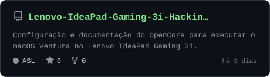

<div align="center">

</div>
<br/>
```bash
thallesgsrv@github ~ $ ls projetos/
```
 
<!-- PROJECTS:START -->
<div align="center">

<a href="https://github.com/thallesgsrv/Big-O-Library"></a>
<a href="https://github.com/thallesgsrv/Miller-Rabin-ProjetoMassoni"></a>
<a href="https://github.com/thallesgsrv/interactive-3d-Rubiks-Cube"></a>
<a href="https://github.com/thallesgsrv/ascii-cam"></a>
<a href="https://github.com/thallesgsrv/bot-ia-discord"></a>
<a href="https://github.com/thallesgsrv/Lenovo-IdeaPad-Gaming-3i-Hackintosh"></a>

</div>
<!-- PROJECTS:END -->
 
<br/>
```bash
thallesgsrv@github ~ $ ./links.sh
```
 
<div align="center">
<a href="https://github.com/thallesgsrv"></a>
<a href="https://www.linkedin.com/in/SEU-USUARIO"></a>
<a href="mailto:SEU-EMAIL@exemplo.com"></a>
 
</div>
 