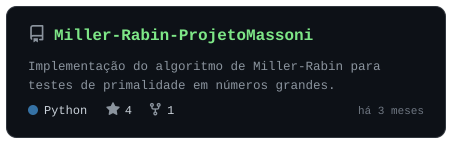
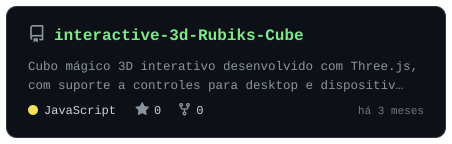
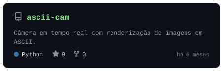
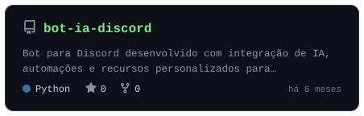
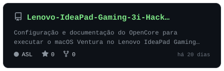

<!-- Todos os cards são SVGs gerados por generate.py e atualizados todo dia pelo workflow update-profile.yml.
     O espaçamento já está dentro dos SVGs: mantenha este bloco sem linhas em branco e sem espaços entre as imagens de uma mesma fileira. -->

 
 
 
 
<!-- PROJECTS:START -->
 

<!-- PROJECTS:END -->
 

