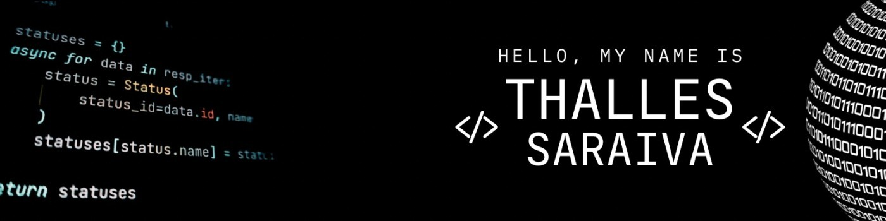

  

<h1 align="center">Hi 👋, I'm Thalles Saraiva</h1>

  <b>Computer Science Student @ UFCG | Software Engineering & Automation</b>

  
  

---

## 📌 About Me

Computer Science student at the **Federal University of Campina Grande (UFCG)**. 

Passionate about building scalable backend systems, workflow automations, and solving complex algorithmic challenges.

* 🎓 **Degree:** B.S. in Computer Science (2025 – Present)
* 💼 **Background:** Ex-IT Intern at Redenet TI
* ⚡ **Focus Areas:** Backend Engineering, API Design, Data Automation, Competitive Programming

---

## 🛠️ Tech Stack

  

---

## 🚀 Featured Projects

| Project | Description | Tech Stack |
| :--- | :--- | :--- |
| **Discord AI Bot** | Private AI-assisted interface powered by local LLMs. | `Python` `Ollama` `Discord API` |
| **ASCII Camera** | Real-time computer vision pipeline with person segmentation. | `Python` `OpenCV` `YOLOv8` |
| **Miller-Rabin Test** | Probabilistic primality test implementation and stress test pipeline. | `Python` `Algorithms` |

---

## 📊 GitHub Stats

  
  

---

  <i>Building, learning and improving every day.</i>

