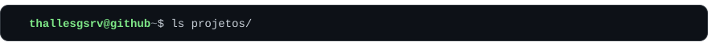

<!-- Todos os cards são SVGs gerados por generate.py e atualizados todo dia pelo workflow update-profile.yml.
     O espaçamento já está dentro dos SVGs: mantenha este bloco sem linhas em branco e sem espaços entre as imagens de uma mesma fileira. -->

 
 
 
 
<!-- PROJECTS:START -->
<!-- PROJECTS:END -->
 

<a href="https://github.com/thallesgsrv">github</a> &nbsp;/&nbsp; <a href="https://www.linkedin.com/in/SEU-USUARIO">linkedin</a> &nbsp;/&nbsp; <a href="mailto:SEU-EMAIL@exemplo.com">e-mail</a>

